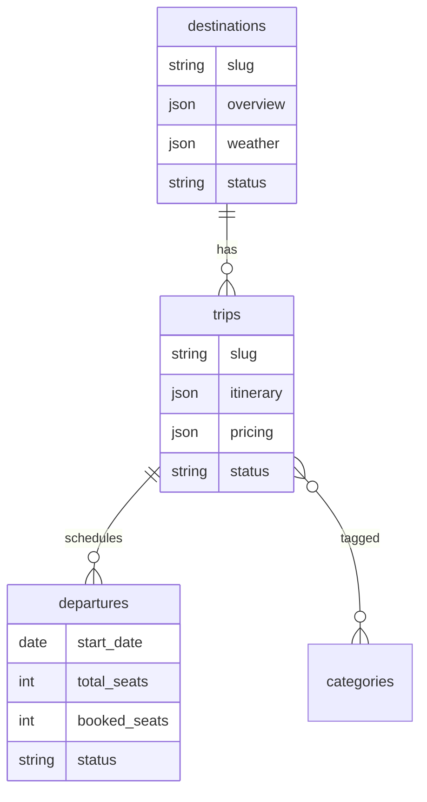

# Backpackclan Travel Portal — Milestone 2 Implementation Plan

**Stack:** Next.js 16 (App Router) + Laravel 13 + MySQL  
**Focus:** Travel Product Management — Trips, Destinations, Departures, Pricing  
**Status:** Not started — builds on completed Milestone 1  
**Reference sites:** [WanderOn](https://wanderon.in), [JustWravel](https://www.justwravel.com), [Capture A Trip](https://www.captureatrip.com)

---

## 1. Milestone 2 Objectives

| Goal | Description |
| ---- | ----------- |
| **Trip Management** | Full CRUD for travel products with rich structured content (itinerary, inclusions, FAQs, testimonials) |
| **Destination Management** | Destination hub pages (Ladakh, Spiti, Kashmir, Bhutan, Nepal + custom) with modular sections |
| **Departure Management** | Calendar-based departures with seat inventory and status badges |
| **Pricing Management** | Multi-tier pricing with offer/strike-through display rules |
| **Admin UX parity** | Same quality bar as M1 — validation, toasts, confirmations, RBAC, mock + Laravel modes |
| **Public-ready data** | Slugged entities, publish workflow, preview routes for trips & destinations |

**In scope for M2:** Admin travel modules, seed data, public **preview** listing/detail pages (no checkout).  
**Out of scope for M2:** Bookings, payments, leads CRM, customer accounts, email notifications, live weather API, automated seat deduction (Milestones 3–4).

---

## 2. Current Project State (Post–Milestone 1)

```
backpackclan/
├── backend/          # Laravel 13, Sanctum, RBAC, CMS API complete
└── frontend/         # Next.js 16 admin + BFF proxy (USE_LARAVEL_API)
```

**Already done (M1):**

- Admin shell, auth, roles/permissions, media library
- Banners, menus, SEO, homepage sections, settings
- Laravel CMS tables + seeders + `/api/v1/admin/*`
- TipTap rich text, mock persistence (`.mock-data/`), homepage preview

**M2 starts from:**

- Homepage “Popular Trips” / “Featured Destinations” sections still use **mock cards** → wire to real trip/destination entities in M2
- SEO has placeholder pages for `/trips` and `/destinations/*` → activate with real meta in M2
- No `trips`, `destinations`, `departures`, or `pricing` tables yet

---

## 3. Architecture Decisions

### 3.1 Domain model (high level)

```
Destination (1) ──< (N) Trip ──< (N) Departure
     │                    │
     │                    ├── Itinerary (day-wise JSON or child table)
     │                    ├── Inclusions / Exclusions (repeaters)
     │                    ├── FAQs (repeaters or polymorphic)
     │                    └── Testimonials (link or embed)
     │
     └── Destination Page Sections (banner, overview, packages, FAQs, weather, map…)

Category (N) ──< (N) Trip     (many-to-many via trip_category)
PricingRule (optional M2+) ── attached to Trip or Departure
```

**Recommendation:** Store flexible repeaters (itinerary days, FAQ items) as **JSON columns** on `trips` for M2 speed; normalize to child tables in M3 if booking analytics need it.

### 3.2 Frontend

| Decision | Choice | Rationale |
| -------- | ------ | --------- |
| Admin forms | React Hook Form + Zod | Consistent with M1 |
| Trip editor | **Tabbed wizard** (Basics → Content → Itinerary → Pricing → SEO → Publish) | Large forms need structure |
| Itinerary UI | Day repeater with drag-and-drop (`@dnd-kit`) | Industry standard for tour CMS |
| Departure calendar | Month grid + list view toggle | Ops teams think in calendars |
| Tables | TanStack Table | Filters, sort, bulk actions on departures |
| Maps | Google Maps embed URL field (M2); Mapbox later | No API key dependency for admin |
| Weather | Manual monthly table (admin-edited) | Live API in M4 integrations |
| Rich text | TipTap (from M1) | Overviews, day descriptions |
| Preview | `/preview/trips/[slug]`, `/preview/destinations/[slug]` | Auth-gated like homepage preview |
| State | Mock stores + Laravel API (same BFF pattern as M1) | Demo without backend |

### 3.3 Backend

| Decision | Choice |
| -------- | ------ |
| API | REST `/api/v1/admin/trips`, `destinations`, `departures`, `categories` |
| Public read API (M3 prep) | `/api/v1/trips`, `/api/v1/destinations` (published only) — optional stub in M2 |
| Permissions | New group: `trips.*`, `destinations.*`, `departures.*`, `categories.*` |
| Slugs | Unique, auto-generated, editable with validation |
| Publish state | `draft` \| `published` \| `archived` |
| Money | Store prices in **paise/cents** (integer) to avoid float bugs |
| Soft deletes | Trips & destinations (recoverable); hard delete departures only if no bookings (M3) |

### 3.4 Sidebar (M2 navigation group)

```
Travel Management          [collapsible]
├── Trips
├── Destinations
├── Departures
├── Categories
└── Pricing Rules          (optional sub-module or inside Trip/Departure)
```

---

## 4. Implementation Phases

### Phase 1 — Foundation & Categories (Week 1)

**Goal:** Types, permissions, categories, shared components.

#### 4.1.1 New permissions (Laravel + frontend)

| Slug | Description |
| ---- | ----------- |
| `categories.view` / `.create` / `.update` / `.delete` | Trip categories |
| `destinations.view` / `.create` / `.update` / `.delete` | Destinations |
| `trips.view` / `.create` / `.update` / `.delete` | Trips |
| `departures.view` / `.create` / `.update` / `.delete` | Departures |
| `pricing.view` / `.update` | Pricing fields (can merge into trips.update) |

Seed: **Editor** gets all except delete; **Viewer** gets `.view` only.

#### 4.1.2 Shared components

| Component | Purpose |
| --------- | ------- |
| `RepeaterField` | Generic label + list for inclusions/exclusions |
| `DayItineraryEditor` | Day number, title, description, meals, overnight |
| `FaqRepeater` | Question + answer (rich text) |
| `TestimonialPicker` | Select from trip testimonials or create inline |
| `PriceInput` | INR formatting, strike-through preview |
| `SeatStatusBadge` | Departure status chips |
| `PublishStatusBadge` | Draft / Published / Archived |
| `SlugField` | Auto-slug from title with edit lock |
| `MapEmbedField` | Paste Google Maps iframe or embed URL |
| `WeatherMonthGrid` | 12-row month editor (temp, conditions, note) |
| `CalendarMonthView` | Departure calendar widget |

#### 4.1.3 Categories module

**Route:** `/admin/categories`

| Field | Type |
| ----- | ---- |
| Name | Text |
| Slug | Text |
| Parent category | Select (optional — e.g. Bike Tours → Ladakh) |
| Icon / image | MediaPicker |
| Description | Rich text |
| Sort order | Number |
| Is active | Toggle |

**Seed categories:** Bike Tours, Treks, Group Tours, Custom Trips, Weekend Getaways.

---

### Phase 2 — Destination Management (Week 1–2)

**Goal:** Destination hub pages with all required sections.

#### 4.2.1 Destination list

**Route:** `/admin/destinations`

- Table/cards: name, slug, country/region, trip count, status, featured flag
- Filters: active, featured, country
- Quick actions: edit, preview, duplicate, archive

#### 4.2.2 Destination editor (tabbed)

**Route:** `/admin/destinations/new`, `/admin/destinations/[id]`

| Tab | Fields |
| --- | ------ |
| **Basics** | Name, slug, region, country, short tagline, hero image (MediaPicker), featured toggle, sort order, publish status |
| **Banner** | Reuse banner fields OR link to M1 banner placement `destination_page` |
| **Overview** | Rich text overview, highlights (repeater: icon + text), gallery (multi MediaPicker) |
| **Packages** | Linked trips multi-select (published trips for this destination) |
| **FAQs** | FaqRepeater |
| **Best Time to Visit** | Rich text + recommended months (multi-select Jan–Dec) |
| **Weather** | WeatherMonthGrid (avg high/low, rainfall note, trek suitability) |
| **Map** | MapEmbedField, optional latitude/longitude for future |
| **SEO** | Meta title, description, OG image (reuse SEO patterns from M1) |

#### 4.2.3 Seed destinations

| Destination | Slug | Region |
| ----------- | ---- | ------ |
| Leh Ladakh | `leh-ladakh` | India |
| Spiti Valley | `spiti` | India |
| Kashmir | `kashmir` | India |
| Bhutan | `bhutan` | Bhutan |
| Nepal | `nepal` | Nepal |

Support **custom destinations** via same CRUD (no hardcoded enum).

#### 4.2.4 Public preview

**Route:** `/preview/destinations/[slug]` — renders all sections in consumer layout (auth-gated).

---

### Phase 3 — Trip Management (Week 2–3)

**Goal:** Complete trip product builder.

#### 4.3.1 Trip list

**Route:** `/admin/trips`

| Column | Notes |
| ------ | ----- |
| Title, destination, categories | Filters |
| Duration (days/nights) | |
| Base price (from pricing) | |
| Departures count | Link to filtered calendar |
| Status | Draft / Published / Archived |
| Featured | Toggle |

Bulk actions: publish, archive, duplicate.

#### 4.3.2 Trip editor (tabbed wizard)

**Route:** `/admin/trips/new`, `/admin/trips/[id]`

**Tab 1 — Basics**

| Field | Type |
| ----- | ---- |
| Title | Text |
| Slug | SlugField |
| Destination | Select |
| Categories | Multi-select |
| Trip type | Select: Bike / Trek / Road Trip / Custom / Mixed |
| Duration days / nights | Number |
| Difficulty | Select: Easy / Moderate / Challenging / Expert |
| Max group size | Number |
| Min age | Number (optional) |
| Cover image / gallery | MediaPicker |
| Short summary | Textarea (card excerpt) |
| Featured | Toggle |
| Publish status | Draft / Published / Archived |

**Tab 2 — Overview**

- Rich text long description
- Highlights repeater (bullet points)
- Route map image or MapEmbedField

**Tab 3 — Itinerary**

- Day-by-day repeater (sortable):

| Day field | Type |
| --------- | ---- |
| Day number | Auto |
| Title | Text e.g. "Manali to Jispa" |
| Description | Rich text |
| Meals | Checkboxes: B / L / D |
| Overnight | Text |
| Distance / altitude (optional) | Text |

**Tab 4 — Inclusions & Exclusions**

- Two RepeaterFields (icon optional + text)
- Quick templates: “Accommodation”, “Meals”, “Permits”, “Bike rental”…

**Tab 5 — FAQs**

- FaqRepeater (trip-specific)

**Tab 6 — Testimonials**

- Inline repeater: name, trip taken, rating (1–5), text, avatar (MediaPicker)
- Or link to global testimonial pool (M3)

**Tab 7 — Pricing** (see Phase 5)

**Tab 8 — SEO & Publish**

- Meta fields + “Preview trip” button

#### 4.3.3 Trip interactions

| Action | Feedback |
| ------ | -------- |
| Save draft | Toast + stay on page |
| Publish | Validation gate (required fields) → toast → optional redirect |
| Duplicate trip | Copy all JSON + new slug suffix `-copy` |
| Delete | Confirm → soft delete → toast |
| Link departures | Shortcut to departure calendar filtered by trip |

#### 4.3.4 Seed trips (minimum 8–10)

Examples: Ladakh Bike Expedition, Spiti Circuit, Kashmir Alpine Trek, Bhutan Cultural Trail, Everest Base Camp (Nepal), etc.

---

### Phase 4 — Departure Management (Week 3–4)

**Goal:** Operational calendar with seat inventory and status automation.

#### 4.4.1 Departure list + calendar

**Routes:**

- `/admin/departures` — list + filters
- `/admin/departures/calendar` — month grid view
- `/admin/trips/[id]/departures` — trip-scoped view

| Column | Description |
| ------ | ----------- |
| Trip | Link |
| Start date / end date | Computed from trip duration |
| Total seats | Integer |
| Booked seats | Integer (manual in M2; auto in M3) |
| Available seats | Computed |
| Status | See status rules below |
| Cancellation deadline | Date |
| Pricing override | Optional per-departure price |

#### 4.4.2 Departure status rules

| Status | Condition (auto-suggest) | Badge color |
| ------ | ------------------------ | ----------- |
| **Available** | `available_seats > 50%` of total | Green |
| **Limited Seats** | `available_seats <= 50%` and `> 20%` | Amber |
| **Last Few Seats** | `available_seats <= 20%` and `> 0` | Orange |
| **Sold Out** | `available_seats === 0` | Red |
| **Guaranteed Departure** | Manual flag (min seats met) | Teal |
| **Booking Closed** | Past cancellation deadline OR manual | Gray |
| **Cancelled** | Manual (ops) | Red outline |

Admin can **override** auto status with manual flag + reason note.

#### 4.4.3 Bulk departure creation

**Modal:** Select trip → date range → recurrence (weekly / bi-weekly) → total seats → generate rows preview → confirm.

#### 4.4.4 Departure form

| Field | Validation |
| ----- | ---------- |
| Trip | Required |
| Start date | Required, not in past (warning only for admin) |
| End date | Auto-filled from trip nights |
| Total seats | Min 1 |
| Booked seats | ≤ total seats |
| Guaranteed departure | Checkbox |
| Booking closed | Checkbox + date |
| Cancellation deadline | ≤ start date |
| Notes (internal) | Textarea |

---

### Phase 5 — Pricing Management (Week 4)

**Goal:** Flexible pricing display for travel portals (strike-through offers).

#### 4.5.1 Pricing model

Attach pricing to **Trip** (default) with optional **Departure** override.

| Field | Type | Description |
| ----- | ---- | ----------- |
| `basePrice` | Integer (INR) | Rack rate |
| `salePrice` | Integer (optional) | Discounted price |
| `showStrikeThrough` | Boolean | Show base crossed out when sale active |
| `offerLabel` | Text | e.g. "Early Bird 15% Off" |
| `offerValidUntil` | Date (optional) | Auto-hide offer after date |
| `currency` | Fixed `INR` in M2 | Multi-currency in M4 |
| `pricePer` | Select | Per person / per bike / per couple |

#### 4.5.2 Price display preview

Live preview card in admin:

```
₹45,999  ₹52,999   [Early Bird 15% Off]
  ^sale    ^base (struck through)
```

#### 4.5.3 Pricing rules (improvement — optional M2 stretch)

| Rule | Example |
| ---- | ------- |
| Early bird | X% off until date |
| Group discount | 4+ travellers |
| Seasonal multiplier | Peak season +10% |

Store as JSON `pricing_rules` on trip; UI can be simple key-value in M2.

---

### Phase 6 — Integration with Milestone 1 (Week 4–5)

**Goal:** Connect travel data to existing CMS.

| Integration | Action |
| ----------- | ------ |
| Homepage “Featured Destinations” | Pick from published destinations (replace mock cards) |
| Homepage “Popular Trips” | Pick from published trips or auto “featured” |
| Menus | Destination dropdown links to real `/destinations/[slug]` |
| SEO module | Add trip + destination page types |
| Banners | `destination_page` placement links to destination entity |
| Dashboard | Widgets: total trips, upcoming departures, low-seat alerts |
| Activity log | Log trip/destination/departure changes |

---

### Phase 7 — Public Preview & Polish (Week 5)

**Goal:** Consumer-facing preview pages and QA.

#### 4.7.1 Public preview routes (auth-gated)

```
/preview/trips                    # listing
/preview/trips/[slug]             # detail: itinerary, pricing, departures, FAQs
/preview/destinations             # listing
/preview/destinations/[slug]      # full destination page
```

#### 4.7.2 Trip detail page sections (preview)

1. Hero (cover + title + price + CTA “Enquire” placeholder)
2. Quick facts (duration, difficulty, group size)
3. Overview
4. Itinerary accordion
5. Inclusions / Exclusions columns
6. Upcoming departures table (status badges)
7. FAQs
8. Testimonials
9. Related trips

#### 4.7.3 Cross-cutting UX (same as M1)

- Sonner toasts, ConfirmDialog deletes
- Loading skeletons, empty states
- `useUnsavedChanges` on long forms
- Responsive admin tables
- Viewer role: read-only trip/destination screens

---

## 5. Complete Screen & Route Map

### Admin

```
/admin/categories
/admin/categories/new
/admin/categories/[id]

/admin/destinations
/admin/destinations/new
/admin/destinations/[id]

/admin/trips
/admin/trips/new
/admin/trips/[id]
/admin/trips/[id]/departures

/admin/departures
/admin/departures/calendar
/admin/departures/new
/admin/departures/[id]
```

### Preview (authenticated)

```
/preview/trips
/preview/trips/[slug]
/preview/destinations
/preview/destinations/[slug]
```

**Total: ~20 admin screens + 4 preview routes**

---

## 6. Data Models (Laravel)

### 6.1 Tables

```sql
categories
  id, name, slug, parent_id (nullable), description, image_id (nullable),
  sort_order, is_active, created_at, updated_at

destinations
  id, name, slug, country, region, tagline, hero_image_id,
  overview (JSON), banner (JSON), highlights (JSON), gallery (JSON),
  faqs (JSON), best_time (JSON), weather (JSON), map (JSON),
  is_featured, sort_order, status (draft|published|archived),
  seo (JSON), created_at, updated_at, deleted_at

trips
  id, destination_id, title, slug, trip_type, duration_days, duration_nights,
  difficulty, max_group_size, min_age (nullable), summary, overview (JSON),
  itinerary (JSON), inclusions (JSON), exclusions (JSON), faqs (JSON),
  testimonials (JSON), cover_image_id, gallery (JSON),
  pricing (JSON), is_featured, status, seo (JSON),
  sort_order, created_at, updated_at, deleted_at

trip_category (pivot)
  trip_id, category_id

departures
  id, trip_id, start_date, end_date, total_seats, booked_seats,
  status (enum), is_guaranteed, booking_closed_at, cancellation_deadline,
  pricing_override (JSON nullable), internal_notes, created_at, updated_at
```

### 6.2 Migration order

1. `categories`
2. `destinations`
3. `trips`, `trip_category`
4. `departures`
5. Extend `permissions` + seed new slugs
6. Extend `activity_logs` module enum (no schema change if module is string)

### 6.3 Seeders

- 5 core destinations + 2 custom samples
- 5 categories
- 10 trips (2 per destination mix)
- 30–40 departures (spread across next 6 months, varied seat status)
- Link homepage sections to seeded trips/destinations

---

## 7. API Routes

### 7.1 Admin (Sanctum + permissions)

```
GET|POST        /api/v1/admin/categories
GET|PUT|DELETE  /api/v1/admin/categories/{id}

GET|POST        /api/v1/admin/destinations
GET|PUT|DELETE  /api/v1/admin/destinations/{id}
PATCH           /api/v1/admin/destinations/{id}  (toggle featured, status)

GET|POST        /api/v1/admin/trips
GET|PUT|DELETE  /api/v1/admin/trips/{id}
PATCH           /api/v1/admin/trips/{id}  (publish, duplicate, feature)
GET             /api/v1/admin/trips/{id}/departures

GET|POST        /api/v1/admin/departures
GET|PUT|DELETE  /api/v1/admin/departures/{id}
GET             /api/v1/admin/departures/calendar?month=2026-08
POST            /api/v1/admin/departures/bulk
PATCH           /api/v1/admin/departures/{id}  (seats, status override)
```

### 7.2 Public (M3 prep — optional stubs in M2)

```
GET  /api/v1/trips?destination=spiti&category=bike-tours
GET  /api/v1/trips/{slug}
GET  /api/v1/destinations
GET  /api/v1/destinations/{slug}
GET  /api/v1/departures/upcoming?trip={slug}
```

Published + `status=published` only; no auth.

### 7.3 Frontend BFF pattern

Mirror M1: `frontend/app/api/admin/trips/*` → `proxyToLaravel()` when `USE_LARAVEL_API=true`.

---

## 8. Mock Data Strategy

```
frontend/lib/mock/
├── category-store.ts
├── destination-store.ts
├── trip-store.ts
├── departure-store.ts
└── travel-seed.json          # optional single seed file
```

- Persist via `createPersistedStore` → `.mock-data/*.json`
- Seed realistic Ladakh/Spiti content for demos
- Departure calendar uses same data; `booked_seats` editable in admin

---

## 9. Suggested Improvements (Beyond Minimum Scope)

These are **recommended** for a production-grade travel CMS:

| # | Improvement | Priority | Notes |
| - | ----------- | -------- | ----- |
| 1 | **Publish workflow** (draft → review → published) | High | Prevents half-finished trips going live |
| 2 | **Duplicate trip / destination** | High | Ops teams copy last season’s product |
| 3 | **Bulk departure generator** | High | Saves hours during season planning |
| 4 | **Auto seat status badges** | High | Core UX on WanderOn-style sites |
| 5 | **Trip–destination SEO** per entity | High | Extends M1 SEO module |
| 6 | **Featured / sort order** on listings | High | Control homepage and listing order |
| 7 | **Gallery & video** on trips | Medium | MediaPicker multi + optional video URL |
| 8 | **Difficulty + fitness tags** | Medium | Filters on public listing (M3) |
| 9 | **Internal admin notes** on departures | Medium | Not shown on public site |
| 10 | **Low-seat dashboard alerts** | Medium | “3 departures &lt; 5 seats” widget |
| 11 | **CSV export** departures | Medium | Ops reporting |
| 12 | **Clone departure** to next week | Medium | Quick calendar ops |
| 13 | **Related trips** block | Medium | Cross-sell on detail page |
| 14 | **Category hierarchy** | Medium | Bike Tours → Himalayan Bike |
| 15 | **Seasonal pricing JSON rules** | Low | Can defer to M3 |
| 16 | **Revision history** | Low | Audit trail for content changes |
| 17 | **Multi-language** (Hindi) | Low | M4+ |
| 18 | **Live weather API** | Low | M4 integrations tab |
| 19 | **Google Maps autocomplete** | Low | Needs API key |
| 20 | **Public trip filters API** | Medium | Prep for M3 customer portal |

---

## 10. Task Breakdown & Timeline

| Week | Focus | Deliverables |
| ---- | ----- | ------------ |
| **1** | Categories, permissions, shared components, destination list + basics | Admin nav updated; categories CRUD; destination basics tab |
| **2** | Destination full editor (all tabs) + seed destinations | 5 destinations seeded; preview destination page |
| **3** | Trip CRUD + itinerary + inclusions/FAQs/testimonials | Trip wizard complete; 5+ seed trips |
| **4** | Departures list + calendar + bulk create + seat status | Calendar view; status badges |
| **5** | Pricing tab + M1 integrations + dashboard widgets | Homepage wired to real trips |
| **6** | Preview pages, Laravel API, QA, documentation | M2 complete; README updated |

**Estimated duration:** 5–6 weeks (1 full-stack developer) or 3–4 weeks (2 developers: FE/BE parallel).

---

## 11. Acceptance Criteria

### Trip Management

- [ ] Admin can create, edit, duplicate, archive, and delete trips
- [ ] Trip includes categories, destination, itinerary, inclusions, exclusions, FAQs, testimonials
- [ ] Trip publish validation blocks incomplete required fields
- [ ] Trip preview page renders all sections correctly

### Destination Management

- [ ] All 5 core destinations seeded and editable
- [ ] Custom destinations can be added without code changes
- [ ] Each destination page includes: banner, overview, packages, FAQs, best time, weather, map
- [ ] Destination preview matches admin content

### Departure Management

- [ ] Calendar and list views show departures filtered by trip/month
- [ ] Seat counts update available seats correctly
- [ ] Status badges reflect rules (or manual override)
- [ ] Cancellation deadline and booking closed states work
- [ ] Bulk departure creation generates multiple rows

### Pricing Management

- [ ] Base price, sale price, strike-through, and offer label display correctly on preview
- [ ] Offer hides after `offerValidUntil` (if set)
- [ ] Per-departure price override works

### System

- [ ] RBAC: editor cannot delete; viewer read-only
- [ ] Mock mode + Laravel mode both functional
- [ ] Activity log records travel module changes
- [ ] Homepage featured destinations / popular trips use real data

---

## 12. Deliverables Checklist

| Deliverable | Output |
| ----------- | ------ |
| **Complete Travel Product Management** | Trips, destinations, departures, categories admin |
| **Pricing engine (display)** | Base/sale/strike-through/offer on trip & departure |
| **Departure calendar** | Month view + seat/status management |
| **Destination hub pages** | Full section model per destination |
| **Preview site** | `/preview/trips`, `/preview/destinations` |
| **Laravel backend** | Migrations, models, seeders, admin API |
| **Documentation** | This plan + README setup section |
| **Demo** | Fully clickable admin with Ladakh/Spiti sample products |

---

## 13. Post–Milestone 2 (Handoff to M3)

M3 typically adds:

- Public trip listing (no auth) at `/trips`, `/destinations/[slug]`
- Booking enquiry form + lead capture
- Seat deduction on booking
- Customer-facing filters (price, date, difficulty)
- Email notifications (departure confirmed, low seats)

Ensure M2 slugs, publish flags, and public API stubs are stable before starting M3.

---

## 14. ER Diagram (Reference)



---

*Document version: 1.0 — Milestone 2 Travel Management System*
